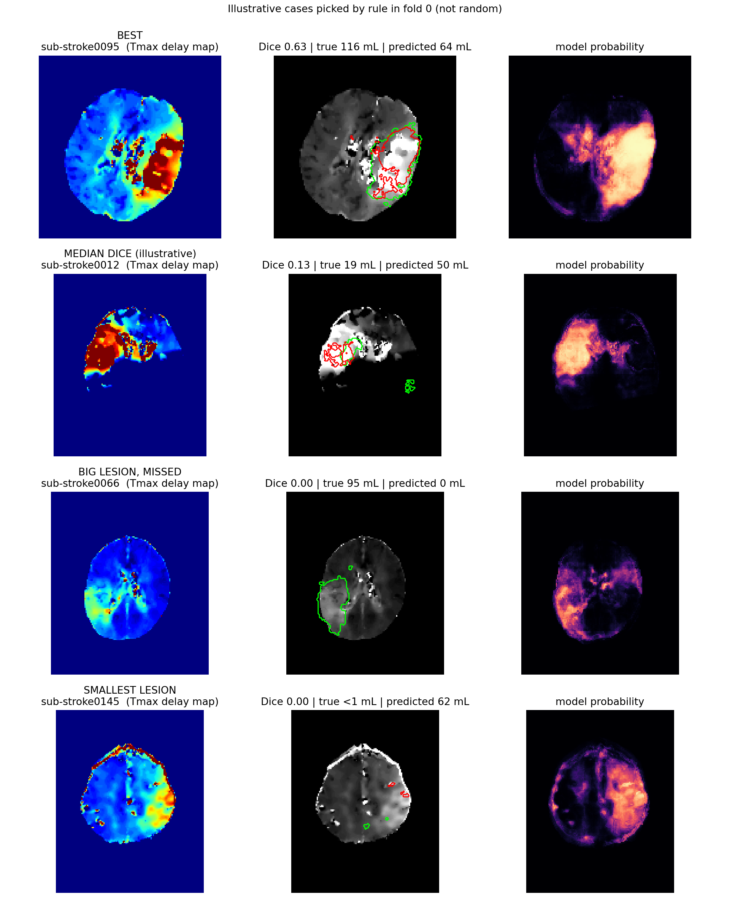
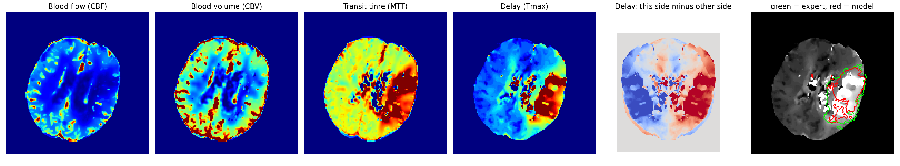

# Lopsided — how much labelled data do you need before a deep network beats a simple model?

A controlled comparison on the public ISLES'24 CT-perfusion stroke dataset. Stroke tissue is predicted voxel by voxel from the four blood-flow maps (CBF, CBV, MTT, Tmax) and scored against expert-marked follow-up lesions, for patients the model has never seen.

**Research study, not a clinical tool.** Nothing here is validated for diagnosis or treatment decisions.

## The question
Small teams rarely have thousands of labelled scans. How does an interpretable, clinical-style model compare with a small U-Net as the number of training patients grows, and what are the failure cases?

## Why it matters
- About 87% of US strokes are ischemic, and stroke-related costs were nearly $56.2 billion in 2019 to 2020 (CDC). For selected patients, thrombectomy up to 16 to 24 hours after onset is guided by perfusion CT volumes from commercial software using fixed thresholds (DEFUSE 3, DAWN).
- Small studies report that those thresholds can misjudge the tissue finally lost, in both directions (ghost core; underestimation in later windows). In our 147 public patients the standard Tmax>6 s region averaged 157 mL against a 32 mL final lesion.
- Our intended user (a hypothesis, not validated) is a small imaging/AI team with roughly 50 to 150 labelled cases. On this one dataset, the study suggests which model to try at each training size, and shows where every model fails.
- **This study does not make or change treatment decisions.** The intended user is a hypothesis to be validated. `docs/CLAIMS_LEDGER.md` lists, for every number, its source, strength and the wording to use.

## Contestants
| Model | What it is |
|---|---|
| `rule_tmax6` | Fixed clinical threshold: Tmax > 6 s |
| `rule_core` | Clinical "core" rule: Tmax > 6 s and rCBF < 30% |
| `rule_best` | Best single feature + threshold, tuned on the training patients |
| `xgb` | XGBoost on 27 interpretable per-voxel features (relative flow, left-right differences, smoothed context, position) |
| `unet_raw` | Small 2-D U-Net on the 4 raw maps |
| `unet_mirror` | Same U-Net, also given the left-right difference channels |

All learned models get the same tuning budget (2 settings, one patient-level validation split, a Dice-tuned threshold), the same patient-level 5-fold split, and train on 80% of the training patients (no refit).

## Headline result (147 patients, 5 patient-level folds)
Mean patient Dice, full data: interpretable model **0.207**, U-Net (mirror) 0.197, U-Net (raw) 0.193, best single threshold 0.173, Tmax>6 s rule 0.135, core rule 0.097.

Which model is best depends on how much labelled data you have:
- **About 10 training patients:** the single tuned threshold beats both learned models.
- **About 40 to 80:** the interpretable model beats the single threshold (+0.02 to +0.03 Dice) and leads the U-Net (+0.02 to +0.05; intervals exclude 0 up to 80 patients).
- **About 118 (the largest size tested):** the two are tied (gap +0.010, 95% CI -0.010 to +0.031).
- The U-Net never overtakes the interpretable model on mean patient Dice (each patient counts equally). Weighted by lesion volume (exploratory) the picture differs: raw U-Net ahead by 0.043 (95% CI 0.010 to 0.074), mirror U-Net tied. See limitations.

Pre-registered equivalence margin: +/-0.05 Dice. Margin sensitivity (checked): the interpretable model is non-inferior to both U-Nets at every margin tested (+/-0.02, +/-0.03, +/-0.05) and "equivalent" only at +/-0.05. Intervals are paired bootstrap over patients.

## Other findings, including the negative ones
- **Left-right comparison helps, but only a little:** removing every left-right feature costs 0.010 Dice (0.207 -> 0.197; 95% CI -0.017 to -0.003).
- **Trust flag:** abstaining where the two models disagree raises Dice from 0.207 to 0.237 at 60% coverage (permutation p = 0.011). A trivial rule ("abstain when the model predicts a small lesion") gains +0.052 vs +0.030, but the difference is not statistically distinguishable (95% CI -0.005 to +0.049). Neither flag catches the over-prediction failure shown below (a large predicted lesion where the true one is small).
- **Two failure modes, shown in images 



(four fold-0 patients picked by rule: best, median-Dice, worst large-lesion miss, smallest lesion; not random)** (`notebooks/lopsided_demo.ipynb`, fold 0): (1) a large blood-flow deficit but a small final lesion, i.e. tissue that was saved by treatment, gives large false alarms (e.g. sub-stroke0012: expert 19 mL, model 50 mL, Dice 0.13; sub-stroke0145: lesion under 1 mL, model 62 mL); (2) a large lesion with little delay on the Tmax map is missed entirely (sub-stroke0066: expert 95 mL, model 0 mL). Even the best case (sub-stroke0095, Dice 0.63) under-segments (116 mL expert, 64 mL model). The model finds the blood-flow deficit; the labels record what was ultimately lost, so Dice is limited by the labels as well as the model.
- **Lesions made of several separate pieces are much harder:** 76 of 146 patients have at least 10% of their lesion in separate pieces; the interpretable model scores 0.109 on them vs 0.317 on the rest (0.184 vs 0.379 among larger lesions). An association, simple model only.
- **Small lesions fail for every model** (Dice about 0.03-0.05 in the smallest quartile) and so do lesions crossing the midline (about 0.05-0.07).
- **What the models find and miss (derived from stored Dice and volumes; no intervals):** per-patient sensitivity / precision: interpretable 0.39 / 0.22, U-Net (mirror) 0.34 / 0.22, U-Net (raw) 0.32 / 0.23, single threshold 0.38 / 0.17, Tmax>6 s rule 0.47 / 0.10, core rule 0.08 / 0.19. Every model marks much more than the final lesion. The interpretable model beats the single threshold through precision, not by finding more lesion.
- **Subgroups (a check, not a finding):** interpretable-model Dice is 0.216 for women vs 0.200 for men, 0.220 / 0.207 / 0.194 across age thirds, and 0.159 / 0.178 / 0.294 across admission-severity thirds. Lesions are also larger in the more severe group (median 31 mL vs 8 mL), and Dice rises with lesion size, so the gaps mostly track size. No intervals; no claim about any group.
- **No robustness advantage:** trained on half the patients and tested on the other image-resolution group, Dice dropped 0.039 (interpretable), 0.033 (U-Net), 0.011 (single threshold). Confounded by training size.
- **Predicted lesion volume does not forecast 3-month recovery** (Spearman 0.00); true lesion volume does (0.38).
- **Compute:** the interpretable model trains about 4.6x faster on CPU than the U-Net on a T4 GPU (about 179 s vs 830 s per fold) and is smaller (677 KB vs 1,889 KB), but is slower at prediction (3.2 s per patient on CPU vs 0.12 s on GPU).

## What this study does not claim
- A new algorithm, a clinical tool, or state-of-the-art performance (the U-Net is small, 2-D, lightly tuned).
- That the resolution split is a hospital or scanner split (the dataset has no site column).
- That the labels are untreated damage: they are post-treatment infarcts after successful reperfusion, so absolute Dice is modest by construction.
- That we are first. A voxel-level comparison of boosting, random forests, a U-Net and clinical thresholds exists on MRI inputs (https://pmc.ncbi.nlm.nih.gov/articles/PMC8756479), and training-size crossovers have been shown in stroke for severity prediction (Bourached et al., Brain Communications 2024). This work extends that line to public CT-perfusion data in the small-data regime.

## How to reproduce
Free tools only: Google Colab, Google Drive, GitHub.
1. **Data.** Download the ISLES'24 training data (Zenodo record 16813698, or its Hugging Face mirror) and place one parquet file per patient in `MyDrive/isles_data/data/`. Cite the ISLES'24 dataset paper (doi 10.1148/ryai.250603).
2. **Support files.** Put `data_support/folds.csv` and `data_support/features_v2.csv` (committed in this repo) in the Drive folder in `MyDrive/isles_data/`. They come from the Week-2 notebook in `notebooks/`, which you can re-run instead.
3. **Run `notebooks/lopsided_v4h.ipynb` in three stages** (only the U-Net needs a GPU):
   - *Stage 1, CPU runtime:* set `QUICK = False`, run everything. Caches the data, builds features, scores the rules and the interpretable model, runs its training-size curve and the failure map.
   - *Stage 2, T4 GPU runtime:* re-run from the top. Finished work reloads from checkpoints; only the U-Nets are new (several hours on a T4; the main comparison alone took about 2.4 hours).
   - *Stage 3, CPU runtime:* re-run once more for SHAP, the left-right ablation and the trust-flag tests (about an hour).
4. Before Stage 1, you can set `QUICK = True` for a 15-minute smoke test on 24 patients.
5. **Optional add-on cells** (`docs/ADDON_CELLS.md`): pin package versions, margin sensitivity, brain-mask picture, satellite-lesion analysis, trust-flag comparison with an interval, extra training-subset draws, ablation confidence intervals, sensitivity and precision (H), a subgroup check (I) and a volume-weighted comparison (J). Paste them at the bottom of the notebook after Run all.
6. **Prediction images and the one-patient demo:** run `notebooks/lopsided_demo.ipynb` on a CPU runtime (about 15-25 minutes). It re-trains fold 0 with the main-experiment recipe, prints a reproducibility check against the main run, and saves `demo/failure_gallery.png` and `demo/demo_patient.png` (maps, expert vs model outlines, plain-language reasons, trust flag). The four gallery cases are illustrative, picked by rule in fold 0, not typical; in the gallery image, "true 0 mL" for sub-stroke0145 is rounding of a lesion under 1 mL.

Progress is saved after every model and fold, so a Colab disconnect costs minutes. (We have not verified that a from-scratch rerun reproduces every number exactly; see limitations.) Saved-progress files are tagged with `NB_VER`; only change it if model code changes.

## Dependencies
`nibabel`, `pyarrow`, `pandas`, `numpy`, `scipy`, `scikit-learn`, `xgboost`, `shap`, `torch`, `matplotlib`, `tqdm`, `psutil`. Pinned versions are in `requirements.txt` (printed by add-on cell A on Colab, Python 3.13).

## Known limitations
- One public dataset, 147 usable patients; no external validation.
- Labels are post-treatment follow-up infarcts; salvaged tissue is not in the mask.
- 4x in-plane downsampling slightly erodes tiny lesions (same for every model).
- The "brain mask" is essentially the rectangular box where the maps have values, not a skull-stripped brain (mean 2.7 L vs about 1.3 L; see add-on cell C): about half of it is background. Dice ignores true negatives, so model-vs-model comparisons are probably little affected, but the whole-box-median "relative" features and any volume of "brain" in mL are not meaningful. A skull-stripped mask is future work.
- Small 2-D U-Net with only 2 tuning settings; larger or better-tuned networks (e.g., nnU-Net) were not tried.
- The "equivalent" verdict depends on the +/-0.05 margin chosen before the full run.
- The left-right ablation has a paired confidence interval; the position ablation (-0.011) is a single run.
- The "stronger U-Net" used in the training-size sweep was chosen by its score on the same out-of-fold data (0.197 vs 0.193). This slightly favours the deep side, so it errs against the interpretable model.
- At the smallest training sizes the validation set used to choose the threshold has only 3 patients, so the n = 10 results are noisy.
- **Reproducibility, partly verified:** re-training the interpretable model on fold 0 from scratch (`notebooks/lopsided_demo.ipynb`) reproduced the main experiment's per-patient Dice exactly (largest difference 0.0000; mean 0.195 both). The U-Net has not been re-run: the GPU is not bit-for-bit repeatable, so U-Net numbers will vary slightly between runs, and the full pipeline has not been rerun from scratch in one go (results come from three runs that reuse saved progress).
- The small-training-size points for the U-Net, and n = 80, use one random training subset per fold. For the interpretable model and the threshold, n = 10, 20 and 40 were re-checked with 3 random draws and gave the same pattern.
- The clinical rules are our own threshold approximations on the dataset's maps, not the output of commercial perfusion software.
- **Averaging choice (exploratory result):** the headline uses mean patient Dice, so a 1 mL and a 200 mL lesion count equally. Pooled over all voxels (large lesions dominate), the raw U-Net is ahead of the interpretable model by 0.043 Dice (95% CI 0.010 to 0.074; pooled Dice 0.365 vs 0.322) and the mirror U-Net is tied (-0.018, CI -0.047 to +0.014; 0.340 vs 0.322). This was run after seeing the sensitivity/precision table, so it is exploratory, it uses the U-Net that was weaker on mean patient Dice, and it is one of three comparisons. The decision guide by training size is stated on mean patient Dice only; the volume-weighted comparison was run at full data only.
- Sensitivity and precision are derived from stored Dice and volumes; voxel-level ROC-AUC was not saved. Subgroup results have no intervals and are not adjusted for lesion size.
- The main notebook produces tables and curves; the prediction images and the one-patient demo are in `notebooks/lopsided_demo.ipynb`.

## Cost
$0 for the data, code and the interpretable model. The U-Net stage needs several GPU hours (the main comparison alone took about 2.4 hours on a T4), i.e. a few Colab compute units.

## Demo notebook result (run Oct 29, CPU, QUICK = False)
Re-training fold 0 reproduced the main run: 30 patients, mean Dice 0.195 in both, largest per-patient difference 0.0000. In fold 0 only, mean Dice is 0.195 on all 30 patients and 0.253 on the 18 the size flag leaves alone (illustrative, one fold, no interval).
One-patient demo (`DEMO_ID = sub-stroke0095`, the best fold-0 case): expert lesion 116 mL, model 64 mL, Dice 0.63. The model outline sits inside the expert outline (it under-marks). Top reasons at the most suspicious voxel: smoothed left-right Tmax difference (+1.79), smoothed MTT (+0.88), smoothed CBF (+0.64), smoothed Tmax (+0.59), smoothed left-right MTT difference (+0.55). The size flag stays quiet (64 mL is above the 24 mL cut-off). Single-voxel explanation, illustrative only.



## Repository layout
```
notebooks/     lopsided_v4h.ipynb, lopsided_demo.ipynb, week-2 feature notebook
data_support/  folds.csv, features_v2.csv
docs/          PROJECT_STATEMENT.md (original plan, margin fixed in advance), CLAIMS_LEDGER.md,
               MODEL_CARD.md, PLAYBOOK.md, ADDON_CELLS.md
figures/       result figures   results/  small result tables
```
Drive paths in the notebooks (`MyDrive/isles_data/...`) are examples; adapt them to your own Drive.

## License and data
Code and documents: MIT (see `LICENSE`). The ISLES'24 data is not included and keeps its own license; check the Zenodo record before reuse. Cite the ISLES'24 dataset paper (doi 10.1148/ryai.250603).
